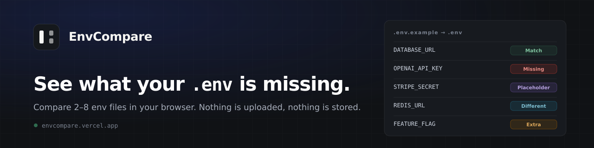

<div align="center">



# EnvCompare

**See what your `.env` is missing — without your secrets leaving the browser.**

[](https://github.com/SynergyFlowLabs/env-compare/actions/workflows/ci.yml)
[](LICENSE)
[](docs/PRIVACY.md)
[](#features)
[](CONTRIBUTING.md#privacy-invariants-not-negotiable)
[](#quick-start)

[**Open the app**](https://envcompare.vercel.app) · [Privacy model](docs/PRIVACY.md) · [PRD](docs/PRD.md) · [Design](docs/DESIGN.md) · [Contributing](CONTRIBUTING.md)

</div>

---

AI agents are designed **not** to touch `.env` files, so they write `.env.example` instead and you fill in the real file by hand. Then the project grows, the example gains keys, your `.env` quietly drifts behind it, and nothing warns you until the app dies with a `401`.

A `diff` cannot help. It compares lines, not variables, and says nothing about the two failures that hurt most:

```bash
OPENAI_API_KEY=          # defined, but empty       → fails at runtime
OPENAI_API_KEY=changeme  # still the example value → fails at runtime
```

Both pass a naive "does this key exist?" check. EnvCompare doesn't.

```
.env.example                   .env
─────────────────────────────   ─────────────────────────────
DATABASE_URL      postgres… ✓   DATABASE_URL      postgres… ✓
OPENAI_API_KEY    sk-…      ✓   OPENAI_API_KEY              ⊘
STRIPE_SECRET_KEY changeme  ✎   STRIPE_SECRET_KEY changeme  ✎
RESEND_API_KEY    re_…      ✓   RESEND_API_KEY    re_OLD…   ≠
# SENTRY_DSN                ⫽   SENTRY_DSN                  ⊘

⊘ missing   ✎ placeholder   ⫽ commented out   ✓ set   ≠ set differently
```

Paste your files, read the summary, fix the table, copy the block. Everything happens in one tab; close it and the data is gone, because it was never written anywhere.

## Features

| | |
| --- | --- |
| **Six states, not a diff** | Every variable in every file is `missing` · `empty` · `placeholder` · `commented out` · `set` · `set differently`. Each state has a colour, an icon *and* a word, so colour is never the only signal. |
| **Two to eight files** | One reference (auto-detected by name, or pinned from any box) and N targets. The table grows a column per file; the fix panel acts on the file you are looking at. |
| **Four views** | A plain-language **Summary**, a row-aligned **Table** (default) with inline editing, the annotated **Raw** text, and the copy-ready **Fix**. |
| **You get the fix, not the diagnosis** | `Copy 3 variables for .env` produces a block with blank values, ready to paste. Exports never contain a value. |
| **Safe with real secrets** | One click hides values — and removes them from the DOM rather than covering them with CSS. Reports and agent prompts are keys-only by default. |
| **Honest placeholders** | `changeme`, `your-api-key`, `<your-key>` and `sk_test_xxxx` are placeholders. `test`, `dummy`, `localhost`, `example` and `password` are not: they appear in real values too often. |
| **Accessible** | Full keyboard path, skip link, visible focus, labelled inputs, real table semantics, and dialogs that trap and restore focus. |
| **Env masking for AI handoff** | The [`/mask`](https://envcompare.vercel.app/mask) page reads a `.env` — two columns, `key` and `value`, comments counted but never treated as variables — and hides the values completely, or keeping a prefix, middle or suffix. Per-key overrides, a preview that *is* the export, and no originals in the output. |
| **No network, no storage** | Static page, no backend, `connect-src 'none'`, no `localStorage`/`sessionStorage`/`IndexedDB`, no analytics. One opt-in cookie holds a theme and nothing else. |

## Quick start

```bash
git clone https://github.com/SynergyFlowLabs/env-compare.git
cd env-compare
npm install
npm run dev            # http://localhost:5173
```

Requires **Node 22+**. No API keys, no database, no services.

| Command | What it does |
| --- | --- |
| `npm run dev` | Vite dev server |
| `npm test` | Unit and component tests (Vitest + Testing Library) |
| `npm run build` | Typecheck, then a production build to `dist/` |
| `npm run preview` | Serve the production build |
| `npm run privacy` | The privacy guard: storage, network, dependency and CSP rules |
| `npm run test:e2e` | Playwright suite (run `npx playwright install` first) |
| `npm run check` | Tests, build and guard — what CI runs |
| `node scripts/build-badges.mjs` | Regenerate the badges in `docs/assets/badges` |
| `npm run social` | Regenerate the launch cards in `docs/social` (SVG, edit the copy here) |
| `npm run social:png` | Render those SVGs to uploadable PNGs (needs `pip install resvg-py`) |

## How the guarantees are enforced

The privacy claim is not a paragraph in a policy document. Every promise has a mechanism, and every mechanism has a test.

| Promise | Mechanism |
| --- | --- |
| Nothing is uploaded | Static site, no backend or functions. The production CSP sets `connect-src 'none'`, so the browser refuses any request the page could attempt. |
| Your files are never stored | No `localStorage`, `sessionStorage`, `IndexedDB`, cache or service worker, and no cookie ever holds anything you paste. `npm run privacy` fails the build if one of those APIs appears in `src/`. |
| One cookie, only if you ask | Choosing Light or Dark once asks whether it may remember the choice in `ec-theme`, whose value is one word. Decline and nothing is written; the guard confines cookie access to one audited file and checks its `SameSite`, `Path` and `Max-Age`. |
| No third-party code that reports back | Runtime dependencies are a short reviewed allowlist — React, three Radix primitives and four small utilities — checked in CI. No font CDN, analytics, tag manager or error reporter. |
| No shareable links | No URL or hash state, so a file name or value can never reach browser history, a screenshot of the address bar, or a `Referer` header. |
| Masking is real | Masked values are removed from the DOM, not hidden with CSS. |
| Exports are safe | Fix blocks, agent prompts and default reports contain key names only. |

Verify it yourself in about thirty seconds: open DevTools → Network, clear it, use the tool, watch nothing go out. Then check Application → Storage: Local Storage, Session Storage and IndexedDB are empty, and the only cookie — if you said yes — is `ec-theme`.

The threat model, and the things this tool explicitly cannot protect you from (browser extensions, your clipboard, a screen recording, someone with your unlocked device) are in [docs/PRIVACY.md](docs/PRIVACY.md). The reasoning and the amendments are recorded in [PRD §13](docs/PRD.md#13-privacy-and-security-architecture).

## How it decides

Correctness is the whole product. A false "you're missing something" teaches people to ignore the tool.

- **Parsing matches `dotenv`.** Quotes, `export` prefixes, `#` comments, duplicate keys, multi-line values, CRLF and BOM are parsed the way `dotenv.parse()` parses them, asserted against 32 fixtures. Where we deliberately differ, [PRD §12](docs/PRD.md#12-parsing-and-comparison-specification-normative) says so.
- **Row order is stable.** The reference file's order first, then keys that only targets have, in the order they appear.
- **The fix is a surgical patch.** Edits splice the original text, so comments, ordering and quoting survive untouched. Nothing is reformatted.
- **Values never leave unasked.** Comparison happens locally; only the cell you reveal renders a value.

## Tech stack

- **React 19** + **TypeScript**, built with **Vite**
- **Tailwind CSS v4** with a hand-written palette ([`tokens.css`](src/styles/tokens.css)) — light and dark from one source of truth
- **shadcn/ui** components copied into [`src/ui/components/ui`](src/ui/components/ui) rather than pulled from a package
- **Radix** primitives for dialog and tabs; **lucide** for icons
- **Vitest** + Testing Library for unit and component tests, **Playwright** for the browser suite
- **No backend.** Deploys as static files to Vercel; `vercel.json` carries the CSP, cache and rewrite rules

## Project layout

```
src/core/             parsing, comparison, patches, exporters, env masking — pure TypeScript, no DOM
src/state/            one reducer, no persistence
src/ui/components/    product components
src/ui/components/ui  shadcn/ui primitives (button, card, dialog, tabs, table…)
src/styles/           tokens.css (the palette) + the Tailwind theme
components.json       shadcn configuration
docs/PRD.md           the specification, written before the code
docs/DESIGN.md        palette, type, layout, motion, copy
docs/PRIVACY.md       the long version of the privacy claim
docs/assets/          banner and generated README badges
docs/social/          launch images and the captions that go with them
e2e/                  Playwright: no-network, no-storage, masked-DOM, hostile-storage
tests/                unit and component tests, plus parser fixtures
scripts/              privacy guard, badge and social-card generators
AGENTS.md             conventions for humans and AI agents
PROGRESS.md           build log and the decisions behind it
```

## Testing

```bash
npm test           # 459 unit and component tests
npm run check      # + typecheck, production build, privacy guard
npm run test:e2e   # Playwright, against a production build
```

The suite covers the parser against real-world `.env` shapes, the comparison and export invariants (no value may ever appear in a fix block or a report), every component flow — including a three-file comparison end to end — the theme cookie's consent rules, the metadata and social preview assets, and the privacy guard itself, including negative tests that prove it fails when it should.

## Roadmap

| Version | Scope |
| --- | --- |
| **v1.0** ✅ | Reference auto-detection · six-state classification · 2–8 files · summary, table, raw and fix views · inline editing · add/remove/uncomment with undo · masking · redacted report · copy/download · privacy guard |
| **v1.1** | Framework presets (Next.js, Vite, Docker Compose) · richer `# required` annotations |
| **v2** *(if demanded)* | Shared core as a CLI · a GitHub Action that reports `.env.example` drift in pull requests |

Ideas and votes live in [Issues](https://github.com/SynergyFlowLabs/env-compare/issues).

## Contributing

Contributions are welcome — start with [CONTRIBUTING.md](CONTRIBUTING.md).

- The most valuable contribution is a **parser edge case** with a minimal, fake-value reproduction. It becomes a permanent fixture.
- The [non-goals](docs/PRD.md) are constitutional: PRs that add analytics, storage, accounts or a backend will be declined regardless of quality.
- **Never paste a real secret into an issue or a PR.** Use obvious placeholders.
- Small, focused pull requests get reviewed fastest; `npm run check` must be green.

Good first issues are labelled [`good first issue`](https://github.com/SynergyFlowLabs/env-compare/labels/good%20first%20issue).

## Contributors

<a href="https://github.com/SynergyFlowLabs/env-compare/graphs/contributors">
  
</a>

Built and maintained by [**imgul**](https://github.com/imgul). The full list is in the [contributors graph](https://github.com/SynergyFlowLabs/env-compare/graphs/contributors).

## License

[MIT](LICENSE). The parser is modelled on [dotenv](https://github.com/motdotla/dotenv) (BSD-2-Clause); attribution is in the license file.

<div align="center">
<sub>Built for the moment an agent hands you a <code>.env.example</code> and says "you're all set."</sub>
</div>
